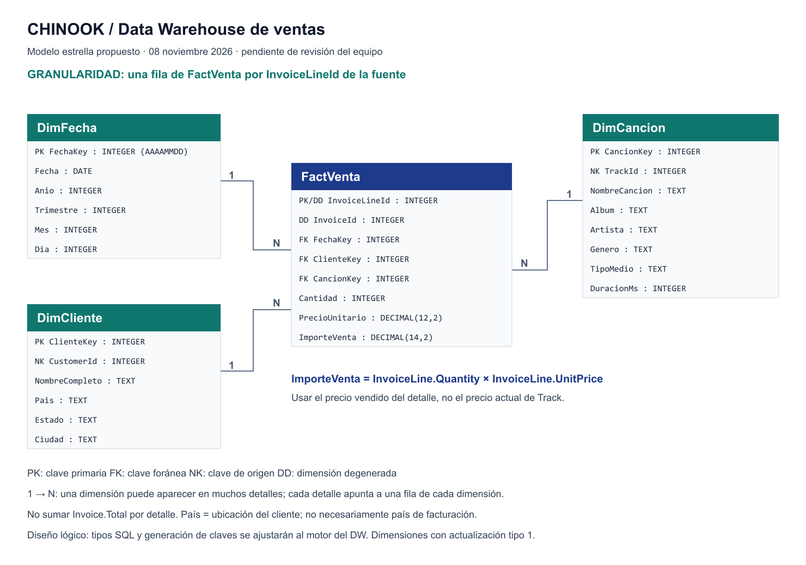

# 05 — Modelo dimensional de ventas de Chinook

Fecha: 8 de noviembre de 2026. Estado: propuesta basada en los CSV recibidos, pendiente de revisión del equipo y validación de objetivos con el profesor.

## Alcance

Analizar ventas de contenido digital. El usuario confirmó inicialmente la asignación de `chinook_digital_store` y Google Cloud Data Fusion. Actualización del 09/11/2026: comunicó autorización para usar AWS y confirmó una instancia RDS MySQL 8.4.11 con conexión desde Workbench. El diagrama lógico se conserva sin cambios; la [guía de implementación](06-crear-dw-mysql.md) concreta la estructura física y su verificación. La carga ETL con AWS Glue sigue pendiente.

Preguntas propuestas:

1. ¿Cuál es el importe vendido por mes y año?
2. ¿Qué canciones, artistas, álbumes y géneros generan más ventas?
3. ¿Qué clientes y países de residencia generan más ventas?

No se considera que estas preguntas ya fueron aprobadas por el profesor.

## Archivos del diagrama

- [Modelo editable en draw.io](diagramas/modelo-ventas.drawio).
- [Vista vectorial](diagramas/modelo-ventas.svg).
- [Imagen para compartir o insertar en Word](diagramas/modelo-ventas.png).

Para editar, abrir <https://app.diagrams.net/>, elegir almacenamiento en el dispositivo si se solicita y usar **Archivo → Abrir desde → Dispositivo** para seleccionar `modelo-ventas.drawio`. Guardar la versión revisada en la misma ruta y volver a exportar las imágenes. El archivo `.drawio` es la fuente editable; la imagen no sustituye ese archivo.

El archivo `.drawio` se conserva como fuente editable. Después de modificarlo en draw.io, volver a exportar las vistas SVG y PNG para que las tres versiones coincidan.

## Granularidad y claves

**Una fila de `FactVenta` representa una fila de `InvoiceLine`**, identificada por `InvoiceLineId`. Una factura puede tener varios detalles.

- `InvoiceLineId`: clave primaria del hecho para esta única fuente y dimensión degenerada que permite volver al detalle original.
- `InvoiceId`: dimensión degenerada para agrupar los detalles de una factura, sin crear una dimensión que solo contenga el identificador.
- `ClienteKey` y `CancionKey`: claves sustitutas del DW. `CustomerId` y `TrackId` se conservan como claves naturales únicas en sus dimensiones para resolver las cargas.
- `FechaKey`: clave determinista de calendario con formato entero AAAAMMDD, derivada de `Invoice.InvoiceDate`.
- Cada hecho debe apuntar a exactamente una fila de cada dimensión. Cada dimensión puede estar asociada con cero o muchos hechos.

## Mapeo fuente → destino

| Destino | Fuente y transformación |
| --- | --- |
| `DimFecha` | Calendario continuo entre las fechas mínima y máxima de `InvoiceDate`; derivar fecha, año, trimestre, mes y día |
| `DimCliente` | `Customer`; conservar ID, unir nombre y apellido, incluir país, estado y ciudad |
| `DimCancion` | `Track` unido a `Album`, `Artist`, `Genre` y `MediaType`; conservar ID, canción, álbum, artista, género, tipo de medio y duración |
| `FactVenta` | `InvoiceLine` unido a `Invoice` por `InvoiceId`; resolver fecha, cliente y canción mediante sus dimensiones |

Álbum, artista, género y tipo de medio se incorporan como atributos de `DimCancion`. Esto evita normalizar esas categorías en dimensiones encadenadas y mantiene un esquema estrella.

Las dimensiones se cargan con actualización tipo 1: corregir o actualizar atributos sin mantener versiones históricas. Los CSV son una instantánea y no aportan historial de cambios de los clientes o canciones. El país analizado es el de `Customer.Country`, no `Invoice.BillingCountry`.

## Medidas y reglas de agregación

| Campo o indicador | Regla |
| --- | --- |
| `Cantidad` | `InvoiceLine.Quantity`; se suma |
| `PrecioUnitario` | `InvoiceLine.UnitPrice`, precio de la venta; no sumar como indicador de ingresos |
| `ImporteVenta` | `Quantity × UnitPrice`, en decimal exacto; se suma |
| Cantidad de facturas | Contar `InvoiceId` distintos dentro del contexto de análisis |
| Precio promedio por unidad | `SUM(ImporteVenta) / SUM(Cantidad)` cuando la cantidad sea mayor que cero |

No cargar `Invoice.Total` como medida repetida en cada detalle: sumarlo multiplicaría el ingreso por el número de detalles. Usarlo como control independiente para conciliar el ETL. La fuente no incluye un campo de moneda: no etiquetar los importes como USD sin confirmación.

## Comprobaciones sobre los CSV recibidos

Lectura con el módulo `csv` de Python, codificación UTF-8 con soporte BOM y aritmética `Decimal`. Estos resultados describen la fuente local del 8 de noviembre, no un DW ya cargado:

| Control | Resultado |
| --- | --- |
| Facturas | 412 |
| Detalles que deberían producir hechos | 2.240 |
| Clientes fuente | 59 |
| Canciones fuente | 3.503 |
| Intervalo de facturación | 2009-01-01 a 2013-12-22 |
| Cantidad total vendida | 2.240 |
| Importe total de detalles | 2.328,60, moneda por confirmar |
| Facturas cuyo total difiere de la suma de detalles | 0 |
| IDs duplicados en las diez tablas con clave simple | 0 |
| Referencias faltantes en las ocho relaciones examinadas | 0 |

Relaciones comprobadas: detalle→factura, detalle→canción, factura→cliente, cliente→empleado, canción→álbum, álbum→artista, canción→género y canción→tipo de medio. No se ha comprobado aquí toda la calidad de la fuente ni la clave compuesta de `PlaylistTrack`.

Hay 29 estados vacíos en `Customer`. En la dimensión se propone representar ese atributo como `Sin dato`; no descartar esos clientes. Las claves obligatorias o referencias inválidas que aparezcan en futuras entregas deben generar un rechazo registrado, no una eliminación silenciosa. No se encontraron referencias inválidas en las relaciones revisadas de esta entrega.

## Fuera de esta primera estrella

- `Playlist` y `PlaylistTrack`: representan pertenencia al catálogo, no ventas. Unirlas directamente al hecho puede multiplicar las ventas de canciones presentes en varias listas.
- `Employee`: queda para una ampliación de análisis por representante; no es necesario para las tres preguntas iniciales.
- Correos, teléfonos y direcciones completas: no son necesarios para los análisis propuestos.
- Streaming, margen e inventario: no hay evidencia de eventos de reproducción, costos o existencias que permita construir esos indicadores.

## Orden de implementación y validación

1. Revisar las preguntas y el diagrama con el equipo.
2. Ejecutar los scripts preparados para MySQL en RDS y comprobar sus tipos, claves y restricciones.
3. Cargar dimensiones; después resolver y cargar los hechos con AWS Glue, como alternativa autorizada comunicada por el usuario.
4. Exigir unicidad de `InvoiceLineId` y claves naturales de las dimensiones. Repetir la carga no debe duplicar hechos ni cambiar las claves sustitutas de dimensiones ya cargadas.
5. Comprobar 2.240 hechos, 2.240 unidades y un importe de 2.328,60 para esta instantánea, además de conciliación por factura y ausencia de hechos sin dimensión.
6. Conectar Excel y responder las preguntas, diferenciando recuento de detalles de recuento distinto de facturas.

Actualización del 09/11/2026: la estructura MySQL se ejecutó correctamente y se comprobó la primera carga de clientes con 59 filas y 29 estados normalizados; ver [resultados y evidencia](08-etl-dimcliente.md). El diagrama permanece sin cambios. Las cargas de fechas, canciones y ventas y la conexión a Excel siguen pendientes.
