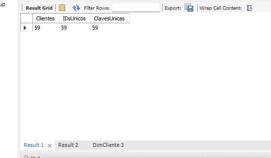
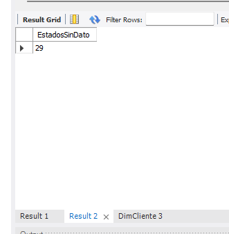

# 08 — Primera carga ETL: DimCliente

Fecha: 9 de noviembre de 2026, Costa Rica. Resultado: carga inicial comprobada con conteos y muestra de MySQL.

## Objetivo y flujo

Leer los clientes de Chinook, preparar sus atributos de análisis y cargarlos en `invacom_dw.DimCliente`:

**Customer CSV (S3) → Transformar clientes (Spark SQL) → MySQL (tabla del catálogo)**.

El job se llama `invacom-load-dimcliente`. [Flujo visual](evidencias/2026-11-09/05-flujo-clientes.png). La infraestructura y los problemas de permisos/red están documentados en [07-infraestructura-aws.md](07-infraestructura-aws.md).

## Extracción

| Opción | Valor |
| --- | --- |
| Nombre del nodo | Customer CSV |
| Tipo de origen | S3 location |
| Ruta | `s3://invacom-chinook-2026/raw/Customer.csv` |
| Formato | CSV |
| Delimitador | Coma |
| Comillas | Dobles |
| Primera fila con encabezados | Sí |
| Escape personalizado / multiline | Sin configurar / desmarcado |
| Recursive | Se indicó desmarcar; la captura anterior al ajuste aún lo muestra activado |

La inferencia detectó las 13 columnas del CSV como texto. Se observaron nombres en minúscula en una captura inicial y con mayúsculas originales en la del nodo SQL; se usaron los nombres del esquema de ese nodo. La ejecución real cargó los datos esperados.

## Transformación

Nombre del nodo: `Transformar clientes`; padre: `Customer CSV`; alias de entrada: `myDataSource`.

Consulta preservada en [etl/sql/transformar_dimcliente.sql](../etl/sql/transformar_dimcliente.sql). Es **Spark SQL dentro de Glue**, no SQL para ejecutar en Workbench:

```sql
SELECT
    CAST(CustomerId AS INT) AS CustomerId,
    TRIM(CONCAT_WS(' ', TRIM(FirstName), TRIM(LastName))) AS NombreCompleto,
    TRIM(Country) AS Pais,
    COALESCE(NULLIF(TRIM(State), ''), 'Sin dato') AS Estado,
    TRIM(City) AS Ciudad
FROM myDataSource
```

| Campo destino | Regla |
| --- | --- |
| `CustomerId` | Convertir el ID a entero; conservar la clave natural de la fuente |
| `NombreCompleto` | Recortar espacios y concatenar nombre y apellido con espacio |
| `Pais` | Recortar espacios de Country; ubicación del cliente |
| `Estado` | Recortar State y convertir vacío o NULL en Sin dato |
| `Ciudad` | Recortar espacios de City |
| `ClienteKey` | No se envía desde Glue; MySQL la genera por AUTO_INCREMENT |

La salida inferida mostró `CustomerId` como int y cinco strings. [Captura de la consulta y tipos](evidencias/2026-11-09/04-transformacion-clientes.png).

## Carga

El nodo MySQL tiene como padre `Transformar clientes`, Database `invacom_catalog` y Table `invacom_dw_dimcliente`. Esa entrada del catálogo apunta a la tabla física `invacom_dw.DimCliente` y reutiliza la conexión registrada.

El aviso **Target node not supported** apareció en Data preview del destino: indicaba que no admite previsualización del nodo, no que el job hubiese fallado.

El primer selector Additional network connections solo mostraba None. Después de configurar el destino desde el catálogo, la captura de Job details mostró `invacom-mysql-connection` en **Current connections**. Esta lista permitió comprobar su asociación sin crear una conexión adicional.

## Parámetros de ejecución comprobados

| Parámetro | Valor |
| --- | --- |
| Rol | AWSGlueServiceRole |
| Tipo / lenguaje | Spark / Python 3 |
| Versión Glue | 6.0 |
| Worker type | G.1X |
| Workers | 2 |
| Autoscaling | Desactivado |
| Reintentos | 0 |
| Timeout | 10 minutos |
| Concurrencia máxima | 1 |
| Bookmarks | Disable |
| Flex / Job Run Queuing | Desactivados |
| Script filename | invacom-load-dimcliente.py |
| Script path | s3://invacom-chinook-2026/scripts/ |
| Temporary path | s3://invacom-chinook-2026/temp/ |
| Job metrics / Continuous logging | Activados |
| Observability metrics / Spark UI | Desactivados |
| Hive metastore / bibliotecas adicionales | Desactivado / sin bibliotecas agregadas |
| Security configuration | None; el bucket conserva su cifrado SSE-S3 predeterminado |

No se añadió una programación recurrente. El [historial de ejecuciones](evidencias/2026-11-09/13-historial-ejecuciones-clientes.png) confirma que la primera ejecución, iniciada a las **23:25:13 del 09/11/2026**, terminó en **Succeeded a las 23:27:19**; la columna Duration muestra **1 min 45 s**. La muestra de MySQL se consultó a las **23:28:22**. También registra una segunda ejecución, de **23:38:18 a 23:41:14**, con estado **Failed** y Duration de **2 min 33 s**. Su mensaje de error no se aportó: la causa queda pendiente de diagnóstico; no se atribuye automáticamente a claves duplicadas. No se verificó el costo final.

Se indicó no repetir la ejecución inicial exitosa porque la carga aún no implementa actualización por clave. Antes de cargar se había creado la tabla vacía; los resultados posteriores comprueban datos presentes y consistencia agregada.

## Validación realizada en MySQL

Se conservaron las consultas en [sql/03_validar_dimcliente.sql](../sql/03_validar_dimcliente.sql).

| Control | Esperado según fuente | Observado en RDS | Resultado |
| --- | --- | --- | --- |
| COUNT(*) | 59 | 59 | Coincide |
| COUNT(DISTINCT CustomerId) | 59 | 59 | Coincide |
| COUNT(DISTINCT ClienteKey) | 59 | 59 | Coincide |
| Estado = Sin dato | 29 | 29 | Coincide |





La [muestra de diez filas](evidencias/2026-11-09/09-clientes-muestra.png) muestra nombres concatenados, claves generadas, países, ciudades y caracteres internacionales legibles. No se realizó una comparación exhaustiva campo por campo de las 59 filas; los controles son agregados y una muestra visual.

## Alcance logrado y pendientes

Completado: primer flujo ETL de clientes, carga en la tabla física y verificación de cantidad, unicidad de claves y normalización de State.

Pendiente:

1. Exportar desde AWS el script PySpark y la configuración visual del job. El archivo SQL preserva la transformación, pero no reemplaza esa exportación.
2. Implementar recarga tipo 1 por `CustomerId`, conservando `ClienteKey`, y probar que dos ejecuciones no cambien conteos ni dupliquen datos.
3. Completar rechazo/control de entradas inválidas y conciliación completa de clientes si se requiere.
4. Cargar `DimFecha`, `DimCancion` y `FactVenta`; después validar ventas por factura y conectar Excel.

No se deben usar DROP, TRUNCATE o eliminación de dimensiones para solucionar una futura recarga con hechos asociados. La clave única evita duplicados, pero no convierte una carga INSERT en una carga idempotente.
