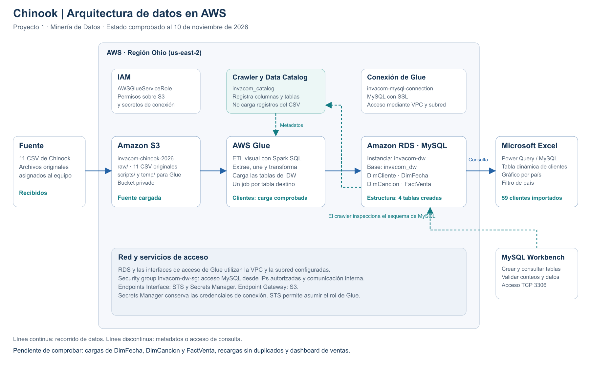

# 10 — Arquitectura de datos en AWS

Fecha: 10 de noviembre de 2026. Representa los recursos y resultados comunicados o mostrados por el equipo; no es un inventario obtenido directamente desde la cuenta AWS.

## Archivos

- [Editable en diagrams.net](diagramas/arquitectura-aws.drawio).
- [SVG para ampliar o exportar](diagramas/arquitectura-aws.svg).
- [PNG para Word y exposición](diagramas/arquitectura-aws.png).

Abrir el archivo `.drawio` en diagrams.net para editarlo. La representación es conceptual: el recuadro exterior agrupa servicios de AWS en Ohio, no implica que S3, IAM o el catálogo estén desplegados dentro de una subred. El detalle de recursos, configuración y límites de evidencia está en [infraestructura AWS](07-infraestructura-aws.md).

## Lectura del diagrama

1. **Fuente:** el equipo recibió los 11 CSV de Chinook y los conservó en S3.
2. **S3:** `raw/` contiene los CSV; `scripts/` y `temp/` son prefijos configurados para Glue. Cada origen selecciona su CSV concreto.
3. **Glue:** los jobs extraen, unen y transforman los datos antes de escribir en MySQL. La carga de clientes está comprobada; las demás cargas todavía requieren confirmación.
4. **RDS:** `invacom-dw` aloja `invacom_dw` con las cuatro tablas del [modelo dimensional](05-modelo-dimensional.md).
5. **Excel:** Power Query consulta RDS. El usuario mostró 59 clientes importados, una tabla dinámica por país y un gráfico con segmentador de país. Los análisis de ventas siguen pendientes.

Las flechas continuas indican el recorrido lógico de los datos. En el tramo de RDS a Excel, Excel inicia la consulta y recibe sus resultados. Las flechas discontinuas distinguen metadatos y consultas administrativas.

El crawler inspecciona las tablas de MySQL y registra sus metadatos en `invacom_catalog`; no ejecuta la carga de los CSV. IAM permite las acciones de Glue. La conexión y la configuración de red proporcionan acceso a RDS, S3, STS y Secrets Manager. Workbench se usa para crear la estructura y validar los resultados.

## Estado y alcance

- Comprobados: fuente recibida, configuración inicial de infraestructura, cuatro tablas creadas, primera carga de clientes y consulta de clientes desde Excel.
- Pendientes de comprobar: cargas de fechas, canciones y ventas, recargas sin duplicados y dashboard de ventas.
- El filtro de país está agregado al gráfico de clientes; no se registra como realizada una prueba de actualización de extremo a extremo tras insertar un cliente nuevo.
- Las tablas staging preparadas localmente no se incluyen: el usuario confirmó haber ejecutado únicamente los scripts iniciales 01 y 02. No se representa `DimEmpleado` como parte del modelo existente.
- No se modifica el diagrama dimensional ni se afirma que todos los recursos sean gratuitos.

Para explicar la arquitectura al grupo, recorrer primero la línea de datos y después los componentes de permisos, catálogo y red. El diagrama no reemplaza la demostración de los jobs y de los resultados de MySQL y Excel.
