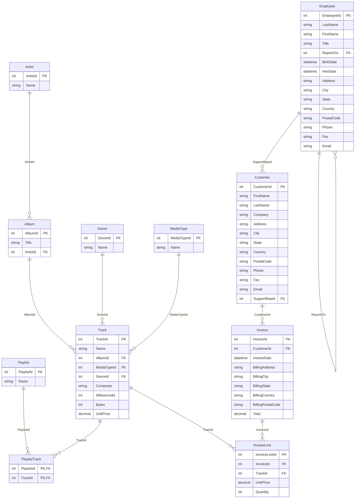

# Modelo de datos de origen — Chinook

!\[Diagrama de origen](diagramas/diagrama\_origen\_chinook.png)

## Diagrama entidad-relación (Mermaid)

## Mapeo origen → Data Warehouse

|Tabla del DW|Archivos de origen|Uniones|Columnas que aporta|
|-|-|-|-|
|**DimCancion**|Track, Album, Artist, Genre, MediaType|`Track.AlbumId = Album.AlbumId` `Album.ArtistId = Artist.ArtistId` `Track.GenreId = Genre.GenreId` `Track.MediaTypeId = MediaType.MediaTypeId`|TrackId, NombreCancion (`Track.Name`), Album (`Album.Title`), Artista (`Artist.Name`), Genero (`Genre.Name`), TipoMedio (`MediaType.Name`), DuracionMs (`Track.Milliseconds`)|
|**DimCliente**|Customer|—|CustomerId, NombreCompleto (`FirstName + ' ' + LastName`), Pais (`Country`), Estado (`State`, nulo → `'Sin dato'`), Ciudad (`City`)|
|**DimFecha**|Invoice|—|Fechas distintas de `InvoiceDate` → FechaKey (`AAAAMMDD`), Anio, Trimestre, Mes, Dia|
|**FactVenta**|InvoiceLine, Invoice|`InvoiceLine.InvoiceId = Invoice.InvoiceId`|InvoiceLineId, InvoiceId, FechaKey (de `InvoiceDate`), ClienteKey (por `CustomerId`), CancionKey (por `TrackId`), Cantidad (`Quantity`), PrecioUnitario (`InvoiceLine.UnitPrice`), ImporteVenta (`Quantity \* UnitPrice`)|

**Granularidad del hecho:** una fila por línea de factura (`InvoiceLineId`).

### Archivos que no se usan en el DW actual

|Archivo|Motivo|Posible uso futuro|
|-|-|-|
|Employee|No hay dimensión de empleados|`DimEmpleado` vía `Customer.SupportRepId` → ventas por representante de soporte|
|Playlist, PlaylistTrack|No representan ventas|Análisis de contenido (canciones por playlist)|

## Puntos de calidad de datos a revisar en el ETL

* `Customer.State`, `Company`, `Fax`, `PostalCode` tienen valores nulos en Chinook.
* `Track.Composer` tiene nulos (no afecta al DW porque no se carga).
* `Invoice.Total` es el total de la factura completa; **no** debe repetirse por línea (se usa `Quantity \* InvoiceLine.UnitPrice`).
* `InvoiceDate` incluye hora (`00:00:00`); se toma solo la fecha para `DimFecha`.
* Verificar en los CSV: separador, encabezados, codificación (tildes en nombres) y formato de fecha.

> Nota: las columnas corresponden a la estructura estándar de Chinook. Se deben verificar contra los encabezados reales de cada CSV en `raw/`.

